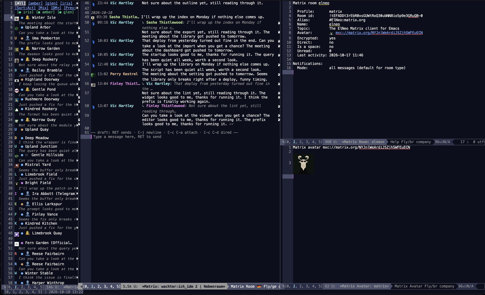

#+title: ElNeo — e2e-enabled Matrix client for Emacs
#+options: toc:2

* elneo                                                               :TOC_4:
- [[#introduction][Introduction]]
- [[#features][Features]]
- [[#installation][Installation]]
  - [[#building-the-daemon][Building the daemon]]
- [[#usage][Usage]]
  - [[#room-buffers][Room buffers]]
  - [[#the-room-bar][The room bar]]
  - [[#sending-files][Sending files]]
  - [[#configuration][Configuration]]
- [[#mode-descriptions-and-keybindings][Mode descriptions and keybindings]]
  - [[#room-buffer][Room buffer]]
    - [[#composing-and-sending][Composing and sending]]
    - [[#messages][Messages]]
    - [[#media][Media]]
    - [[#display-and-navigation][Display and navigation]]
  - [[#room-bar][Room bar]]
  - [[#image-viewer][Image viewer]]
  - [[#verification-buffer][Verification buffer]]
  - [[#account-page][Account page]]
  - [[#session-status-view][Session status view]]
  - [[#options-menu-transient][Options menu (transient)]]
  - [[#org-mode-links][Org-mode links]]
- [[#telega-comparison][Telega comparison]]
  - [[#chat-buffer][Chat buffer]]
  - [[#root-buffer-telega-vs-room-bar][Root buffer (telega) vs room bar]]
- [[#data-storage][Data storage]]
- [[#device-verification-and-key-recovery][Device verification and key recovery]]

* Introduction

ElNeo is a multi-account Matrix client for Emacs, designed for encryption first, heavily inspired by [[https://github.com/zevlg/telega.el][Telega]]. All the Matrix protocol work — connection, sync, encryption — happens in a separate server process per account, Emacs handles the UI on top. Unlike Telega all accounts can be online at the same time.



Potentially privacy violating options are either not implemented, or disabled by default, if possible. There is no support for typing notifications (and probably never will be), and read receipts are private per default (with an option to enable public read receipts). We do track public read notifications of others, though, and show a full list in the channel overview, as it is very useful information for debugging.

There's an encrypted [[https://matrix.to/#/#ElNeo:matrix.org][ElNeo channel at matrix.org]].

Note: This was living as =matrix.el= in my =.emacs.d=, and just got renamed and ripped out over the last few days. While I'm confident most of the matrix->elneo renames are good now there's a good chance of other ties to my config, or specific extensions I'm using:

- heavily ties into [[https://github.com/jwiegley/alert][alert.el]]. While that's designed as an optional module it never really has been tested without.
- heavily assumes [[https://depp.brause.cc/eyebrowse/][eyebrowse]] style workflows, with the assumption that chat buffers typically should be restricted to the eyebrowse desktop containing the room bar. This is the part I expect most to break for non-eyebrowse users
- I have a newer =transient= in my =.emacs.d=. While I don't think this uses features of a newer transient this never has been tested just against the one distributed with emacs.

One very important warning: We currently don't encrypt key material at rest, so at minimum, only use this on devices with full disk encryption. [[https://github.com/aard-fi/elneo/issues/1][Issue #1]] is for discussing implementation options to solve this.

Other bits come down to preference, most importantly, how read messages are handled. I prefer automatically marking messages read once the cursor moves past, which - with the input area at the bottom of the buffer - typically means "whenever I visited a buffer with unread messages". =elneo-room-read-style= is prepared for customising this behaviour - but it has never been tested if that actually works.

The chat buffer placement affinity to the room bar also can cause problems on multi display setups. The placement is frame aware, and in my experience at least works properly with one GUI and one terminal frame.

While CI builds Windows versions of =elneo-server= this code so far has never been tested on Windows.

The device verification workflow is currently a bit less hands off than it should be (i.e., you may have to manually start the verification after adding a device - this was not an issue with my handful of devices which I never touched again after initial setup, so not much work went into this).

* Features

TL;DR: Pretty much everything apart from voice and video calling — voice notes received from others display as waveforms and can be played back with a configured player (sending them is not supported). Media playback relies on downloading media and playing via whatever is configured in emacs to handle that.

- *Multi-account, all online at once*: rooms from every account appear in one merged room bar.
- *Fixed room bar*: one side window spanning the frame height, with live-re-sorting on room activity, and various filter options. The bar folds into a narrow rail (=w= in the bar, or the « handle): one avatar initial and unread badge per room, built for narrow frames and touch (=elneo-room-bar-resting-state= picks the shape a fresh bar starts in; experimental).
- *Room buffers*: history backfill, live message appends, sending, replies, reactions, edits and redactions, read receipts, copy messages and message links, forward messages, pinned messages, drafts surviving buffer kill, encryption backfill, ...
- *Room management*: the =C-c ?= settings view puts actions next to the facts they act on — name and topic, invite/kick/ban, per-room notification modes (all messages, mentions and keywords, muted), leave and forget, and pointers into upgraded rooms.
- *Mention completion*: typing =@= in a room draft offers the room's member roster in a minibuffer picker. =@room= also is available.
- *Media*: on-disk media caching (view with =elneo-media-cache-dired=), background fetching and back-fill. Pictures are displayed inline, video messages show the sender's thumbnail with a =▶= mark, and an image or video caption renders on its own line under the thumbnail; voice notes render as waveforms; =RET= downloads the file and hands it to =elneo-voice-player-command= (a command like mpv) or, when unset, to whatever =elneo-open-file-function= opens media with — =ready-player-mode= makes playback work, the default =find-file= just shows the bytes. Formats Emacs cannot decode are converted on the way in (built-in =image-convert= first, then sips/magick), and images can be rescaled on the way out (a =C-u= on send prompts for a size; =elneo-image-oversize-action= can ask about big ones first). Attaching works by selecting a direct file, selecting via dired, sending from dired, sending from any buffer with a file attached, or by drag and drop.
- *Image viewer*: =v= on an inline picture opens it full-size in a dedicated buffer; =n=/=p= walk the room's images, the =image-mode= zoom keys work, and =o= hands the original to your configured viewer. Room and account avatars open in the same viewer.
- *Polls* (MSC3381): Experimental support for both creating and answering polls - this seems to be about the messiest bit supported here, and with server side unread number counting may do weird things on reported unread messages when people vote.
- *Threads* (MSC3440): there is experimental threads support, with threads marked with =🧵= and a different background colour. Threads can be viewed in an extra buffer, and main buffer replies to thread message also should make it into the correct thread.
- *Space discovery*: =b= on a space's room-bar row (or =M-x elneo-space-browse=) opens the space's page: the rooms the space offers, with member counts and join rules, joinable straight from the listing.
- *Screenshot mode* (=M-x elneo-anon-mode=): rewrites every user-identifiable display string to plausible fake text, while structural bits survive: =(telegram)=-style  bridge suffixes, unread counts, timestamps, reactions, and real images keep rendering. Fakes are render-time only.
- *Encryption-first*: built on matrix-rust-sdk with full E2EE, cross-signing bootstrap, and persistent crypto stores — interactive device verification (SAS emoji compare), key backup, and recovery-key rotation included (see the [[#device-verification-and-key-recovery][device verification and key recovery]] section).
- *Persistent sessions*: each daemon keeps its session, so reconnecting doesn't re-login.
- *Session health*: a daemon that died on its own comes back with a doubling backoff (=elneo-server-auto-restart=), the bar header carries a per-daemon status glyph (click to restart), and the optional =elneo-mode-line-mode= shows unread and mention counts — plus a warning while any daemon is down.
- *Alert integration* (opt-in): =(require 'elneo-alert)= feeds incoming messages into =alert.el=, with cross-device alert cleaning of read messages possible. Full and partial muting of rooms is supported.
- *Org-mode integration*: org links and org-capture support is provided

* Installation

Fastest possible: =make autoloads=, and starting should guide you through downloading =elneo-server= matching your system from the releases page. If that fails, manually download it and place it in your path.

The server can be upgraded using =elneo-upgrade-server=, which usually only is required when the client warns about an outdated server version.

#+begin_src elisp
(add-to-list 'load-path "/path/to/elneo/lisp")
(require 'elneo-autoloads)
#+end_src

For manually building =elneo-server= see below.

** Building the daemon

You'll need a recent Rust stable toolchain, cmake, and a C compiler. Then do =make server=, or

#+begin_src bash
cd server
cargo build --release
#+end_src

Install the binary somewhere on your =PATH=, or point =elneo-server-command= at it.

* Usage

- =M-x elneo-add-account= — log in an account (idempotent); a fresh account picks up cross-signing, secret storage and key backup in the background. You don't need to repeat that after adding accounts - they persist.
- =M-x elneo-start= — bring all accounts online, show the room bar. After accounts are added this is the main entry point.
- =M-x elneo-quit= - end the current session, kill all open elneo buffers.
- =M-x elneo-logout-account= — log an account out server-side; its daemon stops, its rooms close, and the registration stays for a re-login - which will create a new session (device) server side
- =M-x elneo-forget-profile= — delete the registration *and* the profile's on-disk state (session dir with the crypto stores, media cache): the hard uninstall for one account, with a confirmation.
  =M-x elneo-forget-all-profiles= clears every registered profile the same way
- =M-x elneo-setup-cross-signing= — bootstrap cross-signing keys by hand.  Rarely needed: a first-time account gets its keys, secret storage and key backup automatically at login, and a re-login silently adopts the stored recovery key. This is the escape hatch for when that background bring-up failed, or the account's crypto state is inconsistent — and only when this is the account's first device; with another verified device, verify this device instead.

Keys are listed in the [[Keybindings]] table. When sensible Telega bindings are used, for details see the [[Telega comparison]]. The most important keybindings for discovering stuff are:

- in a room, =C-c C-m= for room actions transient, =C-c ?= for room info (most actions also available as buttons there), =C-c  C-b= for the room bar actions transient
- in the room bar, =m= to open the room bar transient. Consider binding =elneo-room-bar-options= to a global key combination.

** Room buffers

The writable draft area at the end of a room buffer is the input - though messages can be sent from any point by pressing =C-c C-c=, or =RET= while not on an item also reacting to =RET=.  Sending directly renders the message with a ⏱ marker, and updates it as server responses arrive. On error, it marks it with ✗, allowing =R= for retry, and =K= for removing the failed message.

Incoming =org.matrix.custom.html= bodies render via =shr=. In the draft area a small markup subset converts to rich text on send: =```== fenced blocks, =`code`=, =**bold**=, =/italic/= and bare http(s) links.  Drafts carrying none of it are sent plain-only. Bare http(s) URLs are recognized in received message text as well they render in the =elneo-room-url-face= face, mouse-1/mouse-2 on the link opens it with =browse-url=, =w= copies the URL at point
to the kill ring, and =RET= on a link opens it instead of prompting to send.

Messages composed while the daemon cannot reach the homeserver are rejected on =RET= with the draft kept; setting =elneo-room-block-send-when-offline= to nil sends regardless.

Invited rooms open with a join / decline / ignore prompt, and a successful accept opens the room.  When the invite is to the successor of a room upgrade (its tombstone names a room still joined here), the prompt carries an extra choice: accept *and* leave the older room.  The leave is never automatic — plain =j= only joins unless =elneo-room-upgrade-leave= is on, and =L= accept-and-leaves without asking again.

Room basics are managed from the =C-c ?= settings view, actions next to what they act on: the Name and Topic facts carry =rename= and =topic= buttons, an =Actions:= row clusters =invite=, =kick=, =ban= and =leave= (=leave= declines an invited room), and a left room offers =forget= instead.  An upgraded room shows =Upgraded to:= / =Continues:= fact lines with =open= buttons into the linked room.  The same actions plus join, room creation, direct messages and the account page are grouped in the =C-c C-m= transient.  Member picks complete over the room's roster (typed user ids work too), bans confirm, leaving asks, and an empty reason or name goes out without the field.

** The room bar

The room bar is a fixed side window holding every registered account's rooms in one list, live re-sorted on room activity; where it sits and how wide it is are =elneo-room-bar-side= / =elneo-room-bar-width=.  =RET= opens the room at point; on an account header it folds that account's section.

The bar's header carries one glyph per daemon: =●= (green) while it talks to the homeserver, =◐= while starting up, =✗= when it is dead or unreachable — =RET= or a mouse click on a glyph restarts that daemon.  A daemon that died on its own comes back by itself: =elneo-server-auto-restart= (default on) re-launches it with a doubling delay from =elneo-server-restart-backoff= (5s, capped at =elneo-server-restart-backoff-max= = 30s); a daemon stopped with =M-x elneo-server-stop= never auto-restarts.  The mode line appends =⚠N= (error face) while any daemon is down, and the global =elneo-mode-line-mode= (off by default) shows =MX[unread/unread-rooms]= with an =!N= suffix while mentions are unread — nothing shows when everything is fine.

Rows carry unread counts, the =👤= direct-message badge, 🔔 on rooms with unread mentions, 🔕 on muted ones, and an =⬆= marker on a room whose upgrade replacement exists — history stays reachable, elneo neither hides nor auto-leaves upgraded rooms.  Invites appear per =elneo-room-invite-display=: an =Invites (N)= section by default, or inline dimmed rows, or hidden entirely.

The rest is keys, telega's rootbuf ones where they translate: =J= joins by =matrix.to= link, room id or alias, =N= / =+= create a room (name, optional alias, public?, topic), =K= leaves the room at point (asks first; on an invite it declines), =u= / =@= jump to the next room with unread messages / unread mentions, =r= marks the room at point read (the same on =R=), =S= cycles the sort (alias =\\=), =s= searches room names, =a= filters by account, =d= between everything / DMs only / rooms only, =G= toggles grouped-by-account, =p= the preview style, =v= the avatar column, =k= the mouse click behavior, =i= the room's settings view, =b= the space page of a space row, =m= the options transient (from a room buffer the same menu is =C-c C-b=; =b= inside it toggles the bar itself), =g= refreshes.  The full table is under [[#room-bar][Room bar]].

Direct rooms come from =M-x elneo-room-start-dm= — a private, encrypted DM with the picked user (roster completion in a room buffer, a typed id elsewhere), opened right away.  The daemon files direct rooms under =m.direct= in both directions, which is what the =👤= badge and the =d= filter read.

** Sending files

Four workflows cover getting a file into a room:

1. *By path* — in a room buffer, =C-c C-a= picks a file with =read-file-name= and inserts a =[image: PATH]= or =[file: PATH]= tag (the type follows the extension) at the end of the draft. Tags mix freely with draft text and with each other, so one message can carry commentary plus several files.
2. *Through a dired picker* — =C-c C-d= in a room buffer opens a dired buffer in a selected directory. Marked files there land in the draft area, similar to the =gnus-dired-attach= flow.  The binding lives only in that dired buffer; the picker closes itself once the files are attached.
3. *From a dired you already have* — mark files in any dired (or put point on one file; directories are skipped) and run =M-x elneo-dired-send-files=. This one sends immediately, no draft involved. The room is picked with completing-read.  Turning on =elneo-dired-auto-target-visible-room= skips the prompt when a room buffer is unambiguous — exactly one is on screen — but as this can lead to accidental sending the prompt is the default. =M-x elneo-send-buffer-file= extends the same immediate-send flow to any file-backed buffer — it sends the file behind the current buffer. From an image-dired thumbnail buffer the image at point is resolved for sending.  A buffer with unsaved edits sends the version on disk with a notice.
4. *Drag and drop* — dropping files from a file manager or any  other application onto a room buffer inserts their =[image: PATH]= / =[file: PATH]= tags into the draft area, exactly like =C-c C-a=: nothing is sent until =RET=.  Only local files attach — everything else you drag keeps the default Emacs behavior.

Any of these flows also works on files behind Tramp: a remote path (=ssh:=, =/sudo:=, ...) is staged to a local temporary copy for the upload — the server doesn't know anything about tramp — and the copy is deleted once the send finishes, by success or failure.

Calling functions capable of attaching an image with prefix argument (=C-u=) will prompt for the largest expected side of an image, and scale before sending.

From any buffer marked text can be sent to a chat with =elneo-send-region-as-code=, mirroring the telega functionality. It'll get inserted into either an active chat buffer, or the selected one, as pre-formatted code block, based on the mode the call came from.

The draft area can also send fontified pastes if =elneo-room-yank-fontify= is on (the default). The bridge filter is applied here as well (i.e., per default this will only go to pure Matrix rooms).

** Configuration

We have a lot of settings, so the recommended way is to use =M-x customize-group= to explore the available groups:

- =elneo=
- =elneo-alert=
- =elneo-anon=
- =elneo-image=
- =elneo-room=
- =elneo-ui=
- =elneo-verify=

You can then either set it through that interface, or note the setting, and sent it with =setq=. If you don't like the various emojis search for =glyph= in the =elneo-ui= group.

* Mode descriptions and keybindings

** Room buffer

Bare keys are commands on the history and self-insert in the draft — the same keystroke dispatches by where point is: on the history it runs the command, in the draft area it types. The command may do different things based on item at point.

*** Composing and sending

| Key     | Command                      | Action                                                   |
|---------+------------------------------+----------------------------------------------------------|
| =RET=     | =elneo-room--ret=              | Send the draft                                           |
| =C-u= =RET= | =elneo-room--ret=              | send the draft prompting once for an image scale         |
| =RET=     | =elneo-room--ret=              | on the history: prompt for the message in the minibuffer |
| =RET=     | =elneo-room--ret=              | on a reply quote: jump to the message it answers         |
| =RET=     | =elneo-room--ret=              | on a link at point: open it in =browse-url=                |
| =RET=     | =elneo-room--ret=              | on a voice message: download and hand it to your player   |
| =C-j=     | =elneo-room--input-newline=    | Newline (multi-line drafts)                              |
| =C-c C-c= | =elneo-room-send=              | Prompt for the message in the minibuffer instead         |
| =C-c C-a= | =elneo-room-attach=            | Attach a file by path (= [image: PATH]= / =[file: PATH]=)  |
| =C-c C-i= | =elneo-room-attach=            | Same command (alias; =C-c C-i= predates the telega policy) |
| =C-c C-d= | =elneo-room-attach-dired=      | Open the dired attach picker for this room               |
| =C-c C-k= | =elneo-room-cancel-reply=      | Cancel a pending reply or edit                           |
| =M-RET=   | =elneo-room-preview-draft=     | Preview the draft rendered exactly as it would be sent   |
| =TAB=     | =elneo-room--complete-mention= | Complete an @-mention (member picker in the minibuffer)  |
| =R=       | =elneo-room--R=                | Retry a failed send (reply context rides along)          |
| =K=       | =elneo-room--K=                | Remove a failed / unsent local block                     |

*** Messages

| Key | Command                      | Action                                                  |
|-----+------------------------------+---------------------------------------------------------|
| =r=   | =elneo-room--r=                | Reply to the message at point                           |
| =a=   | =elneo-room--a=                | React to it (again with your own key: toggle)           |
| =e=   | =elneo-room--e=                | Edit your own message at point                          |
| =M-p= | =elneo-room--edit-previous=    | Edit the previous own text message (M-p again: earlier) |
| =c=   | =elneo-room--c=                | Copy the message text at point                          |
| =l=   | =elneo-room--l=                | Copy its https://matrix.to permalink                    |
| =^=   | =elneo-room--pin=              | Pin the message (again: unpin)                          |
| =d=   | =elneo-room--d=                | Delete (redact) it                                      |
| =f=   | =elneo-room-forward=           | Forward it into another room (any account's)            |
| =p=   | =elneo-room--p=                | Vote on the poll at point (empty clears)                |
| =P=   | =elneo-room-poll-create=       | Create a poll (question, options, disclosure)           |
| =E=   | =elneo-room--E=                | End your own poll at point                              |
| ===   | =elneo-room-show-edit-history= | Show the edit history of the message at point           |

*** Media

| Key | Command       | Action                                                    |
|-----+---------------+-----------------------------------------------------------|
| =o=   | =elneo-room--o= | Open the media message in an external viewer              |
| =v=   | =elneo-room--v= | Open the image at point full-size in the image viewer     |
| =w=   | =elneo-room--w= | Copy the URL at point to the kill ring (link faces count) |
| =I=   | =elneo-room--I= | Retry media display in the current view                   |
| =s=   | =elneo-room--s= | Save the media at point to a file                         |
| =S=   | =elneo-room--S= | Same command (alias)                                      |

*** Display and navigation

| Key     | Command                | Action                                                                      |
|---------+------------------------+-----------------------------------------------------------------------------|
| =C-c ?=   | =elneo-room-settings=    | Room settings buffer                                                        |
| =C-c C-m= | =elneo-room-actions=     | Room management actions menu (transient, see above)                         |
| =C-c C-r= | =elneo-room-refetch=     | Re-fetch the first page of history (escape hatch for a failed fetch/render) |
| =t=       | =elneo-room--t=          | Open the thread the message at point belongs to                             |
| =y=       | =elneo-room--y=          | Toggle rich rendering (=C-u=: follow the global)                              |
| =A=       | =elneo-room--A=          | Toggle the sender avatar column (=C-u=: global)                               |
| =T=       | =elneo-room--T=          | Toggle sender trust marks (=C-u=: global)                                     |
| =<prior>= | =elneo-room-older=       | Load and jump one screen of older history                                   |
| =M-<=     | (scroll to top)        | Loads the first older page; wheel-up keeps position                         |
| =C-c C-b= | =elneo-room-bar-options= | The room bar options menu (global, bindable)                                |
| =q=       | =elneo-room--q=          | Bury the buffer                                                             |

** Room bar

| Key       | Command                              | Action                                                                            |
|-----------+--------------------------------------+-----------------------------------------------------------------------------------|
| =RET=       | =elneo-room-bar-open-at-point=         | Open the room at point; on an account header, fold/unfold its section             |
| =S=         | =elneo-room-bar-cycle-sort=            | Sort: activity / unread / alphabetical                                            |
| =l=         | =elneo-room-bar-toggle-live-sort=      | Live re-sort on activity (on/off)                                                 |
| =a=         | =elneo-room-bar-cycle-account=         | Account filter buttons                                                            |
| =d=         | =elneo-room-bar-cycle-dm=              | DM filter: everything / DMs only / rooms only                                     |
| =b=         | =elneo-room-bar-browse-space-at-point= | Open the space page of the space row at point                                     |
| =s=         | =elneo-room-bar-set-search=            | Search room names                                                                 |
| =g=         | =elneo-room-bar-refresh-full=          | Refresh                                                                           |
| =G=         | =elneo-room-bar-toggle-grouped=        | Grouped-by-account view                                                           |
| =p=         | =elneo-room-bar-cycle-preview=         | Preview style: inline / second line / off                                         |
| =v=         | =elneo-room-bar-toggle-avatars=        | Avatar column (images, colored-initial fallback)                                  |
| =k=         | =elneo-room-bar-cycle-click-action=    | Mouse click action: open / double / point                                         |
| =u=         | =elneo-room-bar-next-unread=           | Open the next room with unread messages                                           |
| =@=         | =elneo-room-bar-next-highlight=        | Open the next room with unread highlights                                         |
| =r=         | =elneo-room-bar-mark-read-at-point=    | Mark the room at point read up to its newest event                                |
| =R=         | =elneo-room-bar-mark-read-at-point=    | Same command (telega rootbuf alias)                                               |
| =J=         | =elneo-join-matrix-to=                 | Join by matrix.to link, room id or =#alias= (prompts for the profile)               |
| =N= / =+=     | =elneo-room-create=                    | Create a room (name, optional alias, public?, topic)                              |
| =K=         | =elneo-room-bar-leave-at-point=        | Leave the room at point (asks first; on an invite it declines)                    |
| =\\=        | =elneo-room-bar-cycle-sort=            | Same command (telega sort-prefix alias)                                           |
| =i=         | =elneo-room-bar-settings-at-point=     | Room settings for the row at point                                                |
| =m=         | =elneo-room-bar-options=               | Options menu (transient popup)                                                    |
| =<mouse-1>= | =elneo-room-bar--mouse-1=              | Move point; open the room per the click action; on an account header, fold/unfold |
| =q=         | =bury-buffer=                          | Bury the bar                                                                      |

** Image viewer

| Key | Command                     | Action                             |
|-----+-----------------------------+------------------------------------|
| =n=   | =elneo-image-next=            | Next photo in the room             |
| =p=   | =elneo-image-prev=            | Previous photo                     |
| =o=   | =elneo-image-open-externally= | Open with =elneo-open-file-function= |
| =+=   | =elneo-image-zoom-in=         | Zoom in                            |
| =-=   | =elneo-image-zoom-out=        | Zoom out                           |
| =0=   | =elneo-image-fit=             | Fit to window                      |
| =q=   | =elneo-image-quit=            | Back to the room                   |

The modeline shows =[position/total]= over the room's photo messages; older photos arrive through filtered history pagination.

The =Matrix Avatar= viewer (a room's or account's avatar picture, opened from the room overview or the account page) has the same shape in miniature: =o= opens the original externally, =q= quits, SPC/DEL scroll.

Note that the image collection viewer is a port of the telega one, and not much used - so probably the biggest "there be dragons" surface of this client.

** Verification buffer

| Key | Command              | Action                                |
|-----+----------------------+---------------------------------------|
| =y=   | =elneo-verify-confirm= | Confirm the short auth string matched |
| =n=   | =elneo-verify-cancel=  | Report a mismatch / cancel            |
| =q=   | =bury-buffer=          | Bury                                  |

** Account page

=M-x elneo-account= (or =M-x elneo-profile=) opens a profile overview, with some customisable settings. Session overview is also reachable from there.  The account itself is editable from anywhere: =M-x elneo-account-set-name= changes the display name (empty clears it), =M-x elneo-account-set-avatar= uploads a picture from disk (=C-u= clears it); both reach the room buffers through the room member events.

** Session status view

=M-x elneo-session-status= is an interactive buffer per profile: cross-signing trust, key backup state, the account's devices, and the pending incoming verification requests.  It is also where the room bar's =Verify: ACCOUNT= row (see *Room bar*) lands - and where you can remove your old client sessions after switching to this permanently.

| Button   | On                                 | Action                        |
|----------+------------------------------------+-------------------------------|
| =[verify]= | a remote unverified device         | Start a verification flow     |
| =[remove]= | any non-current device             | Delete it (password prompted) |
| =[jump]=   | a pending verification request row | Open its verification buffer  |

See the device verification section below for more details on verification and trust.

** Options menu (transient)

=elneo-room-bar-options= (=m= in the bar, =C-c C-b= in a room buffer) opens a transient popup listing every bar setting with its live value; it stays open after each choice so several can be flipped in one visit.

| Key | Action                                                    |
|-----+-----------------------------------------------------------|
| =s=   | Cycle sort order                                          |
| =l=   | Toggle live re-sort                                       |
| =g=   | Toggle grouped view                                       |
| =p=   | Cycle preview style                                       |
| =v=   | Toggle bar avatar column                                  |
| =a=   | Account filter                                            |
| =d=   | DM filter (everything / only DMs / no DMs)                |
| =/=   | Room-name search                                          |
| =c=   | Clear the search                                          |
| =A=   | Global default for sender avatars (re-renders open rooms) |
| =T=   | Global default for trust marks (re-renders open rooms)    |
| =k=   | Cycle the mouse click action                              |
| =r=   | Refresh the bar now                                       |
| =b=   | Toggle the bar (show / hide)                              |

** Org-mode links

=elneo-org.el= registers three link types at load, each opening into the live rooms when followed:

| Link                                  | Opens                               |
|---------------------------------------+-------------------------------------|
| =elneo-room:profile/room-id=            | The room                            |
| =elneo-event:profile/room-id/$event-id= | The room, scrolled to the event     |
| =elneo-user:profile/@user:server=       | The direct chat (started if absent) |

The functionality can be set up as follows:

#+BEGIN_SRC elisp
(with-eval-after-load 'org (elneo-org-install))
#+END_SRC

Usage is via the usual =org-store-link= and the related org-mode functionality - =org-store-link= on a supported object will store the relevant link for insertion somewhere else.

Note that the profile name is part of the link - so this is mostly useful for your own note taking. For sharing event IDs use the other copy functions.

* Telega comparison

[[\[\[https://github.com/zevlg/telega.el\]\[github.com/zevlg/telega.el][Telega]] is the inspiration for this client, and while we do deviate in overall look and feel we try to follow its keybindings when sensible.

- same feature -> telega's key (save is =s=, attach is =C-c C-a=, ...)
- telega features we don't implement yet -> the key stays *reserved* (=m= mark, =i= describe-message, =C-c C-o= input options, ...), and our commands live elsewhere
- new features pick keys telega leaves free (react took =a=)
- exception: when telega's choice fights an Emacs-wide convention, ours wins — =C-c C-c= prompts-and-sends here (as in =message-mode=) instead of telega's filter-cancel

** Chat buffer

| Action                        | telega                        | ElNeo                                                                       | Status                                                                  |
|-------------------------------+-------------------------------+-----------------------------------------------------------------------------+-------------------------------------------------------------------------|
| Send input                    | =RET=                           | =RET=                                                                         | match                                                                   |
| Newline                       | =C-j=                           | =C-j=                                                                         | match                                                                   |
| Input preview                 | =M-RET=                         | =M-RET=                                                                       | match                                                                   |
| Cancel reply (edit/input)     | =C-c C-k= (cancel-dwim)         | =C-c C-k=                                                                     | match; ours cancels a reply only                                        |
| Reply                         | =r=                             | =r=                                                                           | match                                                                   |
| Edit own message              | =e=                             | =e=                                                                           | match                                                                   |
| Delete message                | =d= / =DEL=                       | =d=                                                                           | match                                                                   |
| React                         | — (none in the manual)        | =a=                                                                           | ours                                                                    |
| Forward                       | =f=                             | =f=                                                                           | match                                                                   |
| Mark / favorite message       | =m= / =*=                         | — (key reserved)                                                            | feature missing                                                         |
| Pin message                   | —                             | =^=                                                                           | ours                                                                    |
| Attach file                   | =C-c C-a= / =C-c C-f= / =C-c C-v=   | =C-c C-a= (=C-c C-i= alias), =C-c C-d= picker                                     | match; =C-c C-f= / =C-c C-v= reserved                                       |
| Save media                    | =s=                             | =s= (=S= alias)                                                                 | match                                                                   |
| Copy link                     | =l=                             | =l= (and =c= copies the text)                                                   | match                                                                   |
| Describe message              | =i=                             | — (key reserved; retry media display lives on =I=)                            | feature missing                                                         |
| Input history                 | =M-p= / =M-n=                     | =M-p= walks back through your own last messages (edit-previous); =M-n= reserved | differs                                                                 |
| Link navigation               | =TAB= / =<backtab>=               | =TAB= completes an @-mention in the draft                                     | differs                                                                 |
| In-chat search                | =C-c C-r=, =M-g s=                | — (=M-g= reserved; =C-c C-r= is taken: history refetch)                         | feature missing                                                         |
| Fastnav (unread, date, ...)   | =M-g= prefix                    | — (prefix reserved)                                                         | feature missing                                                         |
| Image viewer                  | =n= =p= =q= (+/-/0 from image-mode) | =n= =p= =q= =o= =+= =-= =0=                                                               | match (port)                                                            |
| Rich/plain input toggle       | =C-c C-e=                       | =y=                                                                           | differs (=C-c C-e= reserved; the toggle moved off =t= when threads took it) |
| Input options transient       | =C-c C-o=                       | — (key reserved)                                                            | feature missing                                                         |
| Minibuffer send               | —                             | =C-c C-c=                                                                     | ours, kept: Emacs convention beats telega's filter-cancel               |
| Room settings / describe-chat | =C-c ?=                         | =C-c ?=                                                                       | match                                                                   |
| Load older history            | infinite scroll, =M-g <=        | =<prior>=, =M-<=, scroll top                                                    | differs                                                                 |
| Bury buffer                   | =q=                             | =q=                                                                           | match                                                                   |

** Root buffer (telega) vs room bar

The bar is a fixed narrow side window, not telega's full-width rootbuf, so telega's rootbuf navigation and view prefixes (=n=, =p=, =t=, =v= views) do not translate one-to-one; the bar keeps =p= (preview style) and =v= (avatar column) as deliberate exceptions.  Everything else follows the same policy:

| Action             | telega          | Ours                                   | Status                   |
|--------------------+-----------------+----------------------------------------+--------------------------|
| Open chat          | =RET= (button)    | =RET=                                    | match                    |
| Bury               | =q=               | =q=                                      | match                    |
| Search             | =s=               | =s=                                      | match                    |
| Describe chat      | =h= / =i=           | =i=                                      | match                    |
| Sort               | =\= prefix        | =S=                                      | differs                  |
| Filter             | =/= prefix        | =a= (accounts)                           | differs                  |
| Grouping           | =v g=             | =G=                                      | differs                  |
| View modes         | =v 0= / =v 1= / =v 2= | =p= (preview style)                      | differs (concept analog) |
| Avatar column      | —               | =v=                                      | deliberate exception     |
| Live re-sort       | —               | =l=                                      | ours                     |
| Mouse click action | —               | =k=, =<mouse-1>=                           | ours                     |
| Refresh            | — (auto)        | =g=                                      | ours                     |
| Join chat by link  | =J=               | =J=                                      | match                    |
| Create chat        | =N= / =+=           | =N= / =+=                                  | match                    |
| Leave / kill chat  | =K=               | =K= (leave at point, asks first)         | match                    |
| Toggle read state  | =R=               | =R= (marks read only — no unread toggle) | differs                  |
| Folders            | =F= prefix        | — (prefix reserved; spaces eventually) | feature missing          |


* Data storage

Client state lives under the platform data directory — on Linux =XDG_DATA_~/elneo= (defaulting to =~/.local/share/=), on macOS =~/Library/Application Support/fi.aard.elneo/=.

For *backups or uninstall*:

- per profile: =session.json= (the session credentials) and the sqlite state and crypto stores — delete the whole data directory to reset an account's local state
- =drafts.el= at the data directory root: unsent room drafts (0600, local only)
- in =~/.emacs.d/=: =elneo-accounts.el= (registered profiles, no secrets) and =elneo-server-<profile>.log= (daemon logs)

*Security note*: the data directory holds the access token (=session.json=) and the encryption keys (sqlite stores), see [[https://github.com/aard-fi/elneo/issues/1][#1]]. Keep its permissions tight. The Emacs side stores only non-secrets (profile name, homeserver URL, user id, device id).  The password is used once for login and never stored — the daemon keeps the access token it issued instead.

Both the lisp and server side have a supported protocol number marker for their communication - a daemon whose protocol is too old for this client is not activated: the session refuses with a message. =elneo-daemon-protocol-allow-outdated= can be used to override it until providing a correct daemon. Overall we degrade gracefully on missing features, but there can be weird exceptions.

The wire protocol itself is documented on the rust side, use =cargo doc --document-private-items --no-deps= in the =server/= directory to view it.

* Device verification and key recovery

Encrypted rooms only decrypt on a trusted session.  New accounts need nothing: on its first login, an account without cross-signing keys gets them, secret storage and a server-side key backup set up by the daemon in the background, and its recovery key is shown once and stored as a file in the session's data dir. The recovery key is re-used in case of a session log-out followed by logging in again.

Existing accounts (keys set up elsewhere, or no backup to adopt from) still use the manual flows, once at most:

1. *Verify the device* (SAS/emoji): =M-x elneo-verify-device= starts  a flow with another device on your account — the other client shows the usual verification dialog with emojis and numbers. Incoming requests from other clients can be accepted with =M-x elneo-verify-accept-incoming=.
2. *Enable key backup*: =M-x elneo-enable-recovery= creates secret storage + server-side key backup and shows a base58 *recovery key exactly once*, with instructions. The daemon keeps its own copy in the session's data dir (file =recovery-key=, mode 0600) for the silent re-login above, but for recovery in case the device is lost must be securely stored off machine.
3. *Restore access from the recovery key*: =M-x elneo-recover-keys= decrypts the account's secret storage, marks this session's identity verified, signs the device, and adopts the existing server-side key backup — it never creates or re-creates one (enabling a backup for an account without one stays =elneo-enable-recovery='s job).  The key the user enters is stored like the enable-time copy (0600 =recovery-key= in the data dir).
4. *Rotate the recovery key*: =M-x elneo-rotate-recovery-key= (or the =rotate= button in the session-status view) builds a new secret storage under a fresh recovery key and re-uploads the account's secret into it; the server-side key backup and its history stay as they are.  The new key is shown once and stashed over the old copy. The key held until now stops working *everywhere* — other sessions,  machines and clients carrying the old key lose their access to the store and need the new one.  A session the store does not trust cannot fill a fresh store on its own: rotating from one asks for the old key and imports it first, from the store's point of view a recover-then-rotate.
5. *Disable recovery*: =M-x elneo-disable-recovery= (or the =disable= button) deletes the server-side key backup, clears secret storage and has the homeserver record the backup as disabled, so nothing    re-enables it behind the user's back.  Encrypted history no other device already holds is gone with the backup — it does not come back.  The daemon also drops its (now stale) recovery-key copy and never re-adopts anything.

*Trust marks*: encrypted rooms can show a mark after each message telling whether the sender's sending device is verified — ✓ for verified, ⚠ for unverified/signed-never-verified, ✗ for a real verification anomaly (the identity no longer matching the sending device). This is off by default - =T= in the room (or the options menu) toggles it, per-buffer override or global default.  Like Element's shields, the marks are a snapshot taken at decryption time: a device verified later keeps its unverified mark on messages that arrived before, and completing a verification re-renders the marked buffers so new arrivals pick up the state.
